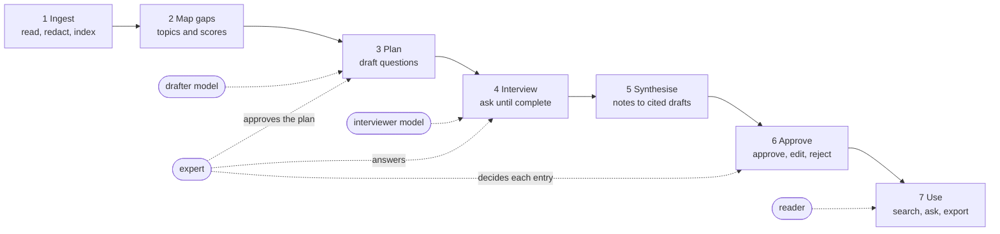
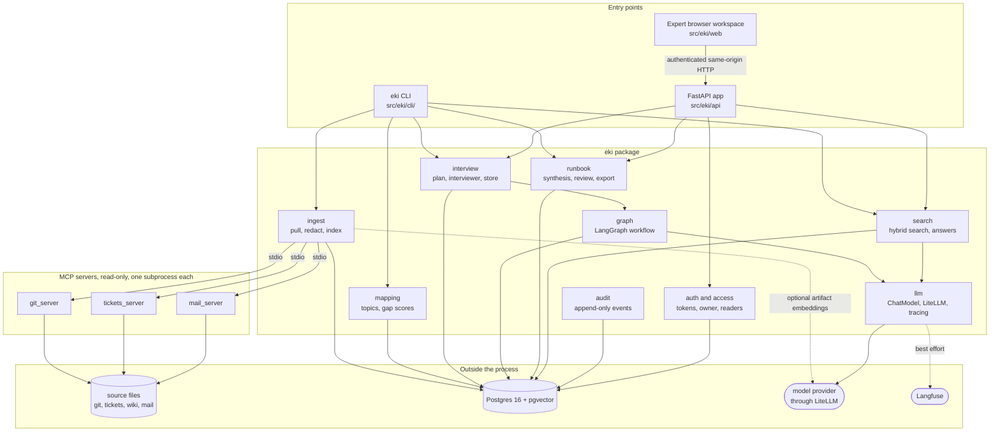
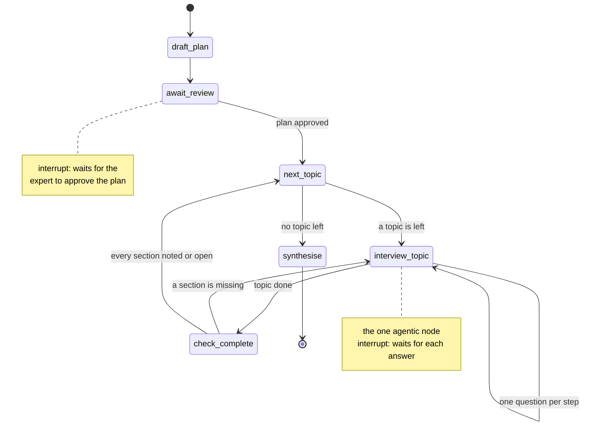
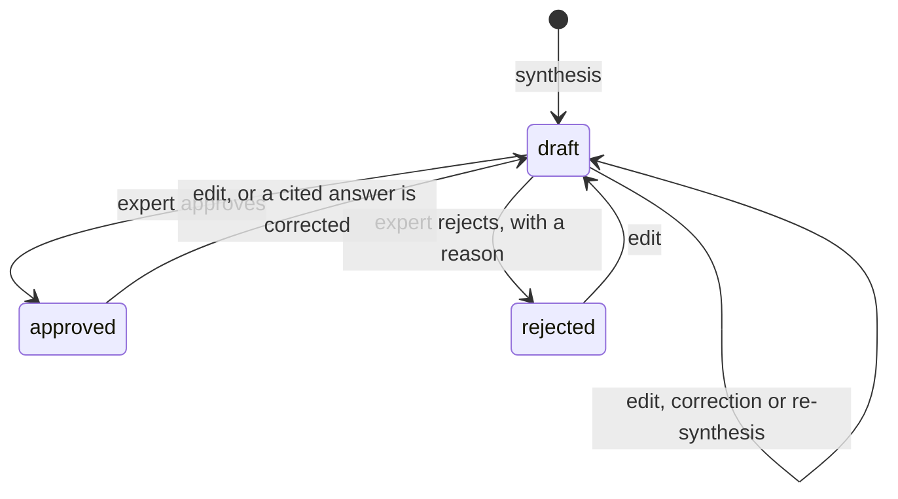
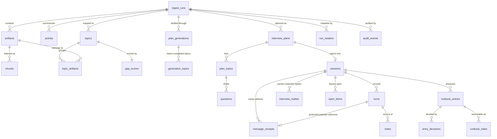

# Architecture

How `eki` is put together: the pipeline, the components, the interview
workflow, the data model and the rules that hold across all of them. For what
happens step by step at runtime, see the flow pages in [flows/](flows/index.md).

All diagrams are Mermaid. GitHub renders them; in VS Code install a Mermaid
preview extension.

## The pipeline

Seven stages turn an expert's work history into a searchable runbook. Drafting
and interviewing require chat models; optional embeddings and an evidence
selector can also use providers during ingestion and retrieval. People decide
twice: the expert approves the plan, and the expert approves every entry.

| Stage | Command | Code | Model |
| --- | --- | --- | --- |
| 1 Ingest | `eki ingest`, `eki reindex-artifacts` | `eki.ingest`, `mcp_servers` | optional artifact embeddings (`EKI_MODEL_ARTIFACT_EMBEDDING`) |
| 2 Map gaps | `eki map`, `eki gaps` | `eki.mapping` | none |
| 3 Plan | `eki plan` | `eki.interview.plan`, `eki.interview.drafting` | drafter (`EKI_MODEL_DRAFTER`) |
| 4 Interview | `eki interview` | `eki.interview.interviewer` | interviewer (`EKI_MODEL_INTERVIEWER`) |
| 5 Synthesise | automatic | `eki.runbook.synthesis` | none |
| 6 Approve | `eki entries`, `eki review` | `eki.runbook.review`, `eki.runbook.faithfulness` | none |
| 7 Use | `eki search`, `eki ask`, `eki export` | `eki.search`, `eki.runbook.export` | optional (`EKI_MODEL_EMBEDDING`, `EKI_MODEL_ANSWERER`) |

Stages 3 to 5 are one LangGraph workflow. Stages 1, 2, 6 and 7 are plain code
called from the command line or the API.

The gap score that orders stage 2 is
`100 x exclusivity x recency x (0.5 x doc_gap + 0.5 x criticality)`
(`src/eki/mapping/scoring.py`).

## Components

Notes on the picture:

- **The CLI does not call the API.** Both call the same services
  (`InterviewService`, `RunbookService`, `SearchService`, `AnswerService`). The
  CLI is a trusted local operator tool with database credentials; untrusted
  readers use the API.
- **Chat calls pass through these wrappers**, outermost first:
  `TracedModel` (Langfuse, best effort) wraps `AuditedModel` (must succeed
  before the call) wraps `LiteLLMModel` (`src/eki/interview/service.py`).
  Provider embeddings use `AuditedEmbedder` around `LiteLLMEmbedder`
  (`src/eki/search/embedding.py`), with the artifact run scope attached explicitly.
- **MCP servers are separate processes** started per ingest over stdio
  (`src/eki/ingest/pipeline.py`). The mail server is started only when mail
  folders were named.
- **Langfuse** needs `EKI_LANGFUSE_PUBLIC_KEY` and `EKI_LANGFUSE_SECRET_KEY`;
  without them tracing is off (`src/eki/llm/tracing.py`). Audit does not
  depend on it.

## The interview workflow

Stages 3 to 5 are a fixed graph with one agentic node
(`src/eki/graph/workflow.py`). Only `interview_topic` lets a model choose
what to do next, and only through six tools.

- **State is checkpointed in Postgres after every step**, one thread per plan
  (`thread_config`, `src/eki/graph/workflow.py`). A stopped process
  continues from the last question.
- **The record lives in tables, not in workflow state.** State holds control
  data and the redacted model conversation of the current topic. Plans, turns,
  notes, open items, receipts, cached redacted replies and generation results
  live in application tables. Accepted submissions are deduplicated; repeated
  identical notes/synthesis retain their records and versions. Changes to an
  accepted answer use an explicit correction (`eki.interview.delivery`,
  `eki.interview.generation`, `eki.interview.store`, `eki.runbook.service`).
- **A topic is complete** when each of the seven sections (trigger, diagnosis,
  steps, rollback, contacts, pitfalls, rationale) has a note or is recorded as
  open. `check_complete` is plain code, so the model cannot declare a topic
  finished on its own (`src/eki/graph/workflow.py`).
- **Limits per topic:** 12 questions and 40 model calls. When a limit is
  reached the remaining sections are marked open (`Limits`,
  `src/eki/graph/workflow.py`).

The interviewer's tools (`src/eki/interview/tools.py`):

| Tool | Effect |
| --- | --- |
| `search_artifacts` | reads ingested artifacts |
| `get_artifact` | reads one artifact |
| `ask_expert` | stores a question and waits |
| `record_note` | stores a note for one section |
| `mark_open` | records a section as unanswered |
| `finish_topic` | ends the topic if nothing is missing |

None of them approves, publishes, sends or writes to a source system.

The expert browser workspace (`eki.web`) is served by FastAPI and calls the
same authenticated API. Message receipts and stored redacted model replies
provide durable delivery; per-topic generation records provide drafting recovery.
See [message delivery](flows/message-delivery.md) and
[plan generation](flows/draft-plan.md) for their replay boundaries. Artifact
queries use the model identity saved with their run; explicit reindexing replaces
that index/model pair atomically.

## Runbook entries

One entry per plan topic, seven sections each. A section holds claims or one
open question. Every claim carries the citation it came from.

- Only `approved` entries are searchable, answerable and exportable.
- Every change increments the entry's version; the search index stores the
  version it was built from and ignores rows of any other version.
- Re-running synthesis rebuilds drafts from the notes. It never touches
  approved or rejected entries, and it keeps drafts the expert edited by hand
  unless `overwrite_edits` is set (`src/eki/runbook/service.py`).
- Approval requires a complete template and a citation on every claim
  (`src/eki/runbook/review.py`).

## Data model

Everything hangs off one ingest run. Deleting a run cascades to all of it,
except audit events, which are kept.

| Tables | Migration | Written by |
| --- | --- | --- |
| `ingest_runs`, `artifacts`, `activity`, `chunks` | 0001, 0007 | `eki ingest` |
| `topics`, `topic_artifacts`, `gap_scores` | 0001 | `eki map` |
| `interview_plans`, `plan_topics`, `questions` | 0002 | plan drafting and review |
| `sessions`, `turns`, `notes`, `open_items` | 0002 | the interview |
| `runbook_entries`, `entry_decisions` | 0003, 0008 | synthesis and review |
| `run_readers`, `ingest_runs.owner_subject` | 0004 | `eki access`, access routes |
| `runbook_index` | 0005 | first search after an approval |
| `message_receipts`, `interview_replies` | 0009 | durable acceptance and replay of redacted model replies |
| `ingest_runs.artifact_embedding_model` | 0010 | artifact index/query model identity |
| `plan_generations`, `generation_topics` | 0011 | per-topic drafting progress and recovery |
| `audit_events` | 0006, 0009, 0011 | model/tool attempts, decisions and delivery/generation transitions |
| `follow_up_gaps`, `follow_up_throttle` | 0016 | explicit reader requests, owner triage, resolution history and shared-worker request limits |
| `follow_up_attempts`, `session_usage`, `session_provider_attempts` | 0017 | selected seed outcomes and durable follow-up budgets |
| `follow_up_proposals` | 0018 | private section proposals and authorized cross-session source lineage |
| LangGraph checkpoint tables | created by `eki migrate` | the workflow |

Migrations are in `src/eki/migrations/` and are applied in order by
`eki migrate`.

## Rules that hold everywhere

**Redaction comes first.** Secrets and personal email addresses are replaced
with `[REDACTED:kind]` before text is stored, indexed, logged, traced or sent
to a model (`redact`, `src/eki/ingest/redaction.py`). It is applied more
than once on purpose:

| Where | Code |
| --- | --- |
| In each MCP server, before a tool returns | `mcp_servers/common/source.py` |
| In the ingest client, again, on every artifact | `src/eki/ingest/pipeline.py` |
| On the expert's answers and corrections | `src/eki/interview/service.py` |
| On everything the model writes | `src/eki/interview/interviewer.py` |
| On every message sent to a provider | `src/eki/llm/litellm_model.py` |
| On every trace sent to Langfuse | `src/eki/llm/tracing.py` |
| On search queries and questions | `src/eki/search/service.py` |

Storage functions accept only the `RedactedText` type for anything a person or
a model wrote, so an unredacted string is a type error.

**Ingested content is data.** Artifact text reaches a model inside marked data
blocks, and the model is told not to follow instructions in it. The stronger
protection is structural: the interviewer has no tool that could act on such
an instruction.

**Confidential answers stay out.** An answer marked confidential is stored and
flagged. The model is told only that the section was answered
(`src/eki/interview/interviewer.py`); the runbook shows a fixed marker.

**Access.** API data routes need a bearer token from `EKI_API_TOKENS`. A run
has one owner and a list of readers. Owners and admins manage a run and see
drafts; readers see approved entries only; everyone else gets 404
(`src/eki/api/security.py`, `src/eki/access.py`).

**Audit.** Every model call, tool call and decision is written to
`audit_events` with run, user and call ID, and no content. The write must
succeed before a model or tool call is made (`src/eki/audit.py`).

## Not built, or not verified

- **Real sources.** The connectors read the synthetic local corpus only. There
  is no adapter for a live mailbox, GitHub or an issue tracker.
- **Real models.** Tests use scripted model doubles. Interview quality,
  semantic search and model-selected answers are unverified until the opt-in
  live tests are run with a provider key.
- **Plan editing from the CLI.** Removing, adding and reordering topics is
  available in the browser and API (`PATCH /plans/{id}`), not as a CLI command.
- **Visual browser QA.** The [expert workspace](flows/browser-workspace.md) is
  implemented with HTTP and client-logic coverage. Actual browser interaction
  and visual/accessibility verification remain pending because browser control
  was unavailable. Live provider validation remains deferred by user request.

## Phase 8: maintenance after capture

An explicit handover keeps the original expert/source identity while moving
entry-review authority to the existing run owner subject. Capture then closes;
maintenance edits create attributed human turns. Review dates and reader flags
are live metadata, separate from publication/content version and embeddings.
Q&A excludes overdue entries while search/export label them. New tables are
`handovers`, `entry_flags` and `flag_throttle` (0013), with confirmation ordering
(0014) and metadata-safe index invalidation (0015). Shared services enforce run,
session, entry and flag locking; HTTP and CLI do not authorize by a display name
in maintenance. See [the maintenance flow](flows/maintenance.md).

## Phase 9: focused follow-up and reviewed publication

Public open sections and explicitly saved reader questions feed a run-scoped
private queue. The owner maps/selects seeds, freezes a bounded plan and the original
expert approves it. The existing graph enforces selected sections and per-seed
attribution with durable question/provider limits. Finishing a mapped topic saves
a private proposal; applying selected sections revises the same entry to draft and
invalidates publication. Separate ordinary approval publishes it and resolves
eligible open-section gaps. Reader requests require explicit reviewer confirmation
linked to an approved version. Cross-session citations, faithfulness and corrections
use entry/topic lineage and preserve the actual source session IDs. Browser, CLI
and HTTP share these transitions and authorization. See [the follow-up flow](flows/follow-up.md).
