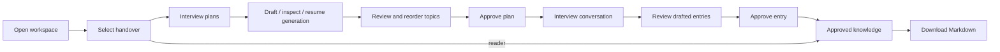

# Expert browser workspace

**Entry:** `/` on the FastAPI server, normally <http://localhost:8000/>.
**Outcome:** an expert reviews a plan, completes an interview, approves cited
entries and exports them. A reader can browse approved knowledge shared with
their identity.

The browser is a React/TypeScript client in `frontend/`, built with Vite into
`src/eki/web/static/workspace/`. The committed production build is served by
FastAPI at `/` and `/workspace/*`; its scripts and styles use
`/assets/workspace/`. Browser paths have their own prefix so they cannot shadow
the API's `/plans`, `/sessions` or `/entries` routes. Missing static files still
return 404. It uses the same authenticated API as other clients. Ingestion and
mapping remain CLI setup steps.

To develop the frontend, run `npm ci` and `npm run dev` in `frontend/`, with the
FastAPI server running on port 8000. Vite proxies data requests to that server.
Run `npm run build` to type-check and update the production assets. Serving the
committed build needs no Node process; FastAPI serves it on the same origin as
the API.

## Prepare a handover

1. Run `uv sync` and `uv run eki migrate`. Ingest the selected synthetic sources,
   then run `uv run eki map --run RUN_ID`.
2. Assign the run to the intended account subject, for example
   `uv run eki access --run RUN_ID --owner nadia`.
3. Set `EKI_PUBLIC_ORIGIN` to the browser's origin and create an account with
   `uv run eki users add --email nadia.ferrand@example.com --name "Nadia Ferrand" --subject nadia`.
   Use the same subject/name as an existing bearer identity when migrating it.
4. Start `uv run uvicorn eki.api.app:app --reload`. Restart after changing
   origin, token registration or model configuration; account changes are immediate.
5. Open the printed invitation link, set a password, and select the handover.
   Later visits to `/` use email and password. See [sign in](sign-in.md).

A server-side session is restored through `GET /auth/session` after a reload,
keeping the current URL. Saved work comes from the server; unsent answers stay
in tab memory and are not persisted across a page reload. The browser warns
before leaving with an unsent answer and confirms before signing out.

## Walk through the workspace

| Area | Available actions |
| --- | --- |
| **Interview plans** | Draft a plan; inspect saved generation progress; resume unfinished topics; open an existing conversation. |
| Plan review | Read source quotations; move, remove or add topics; explicitly approve the completed plan. Partial generations cannot be approved. |
| Conversation | Save an answer; mark it confidential; skip; select an earlier answer to correct it. |
| Conversation recovery | Resume a saved receipt or recover an interrupted step without submitting its answer again. |
| **Review entries** | Inspect sections, citations, open questions and unsupported-term flags; read permitted source turns; edit, reject or approve. |
| **Approved knowledge** | Search, ask cited questions, open approved entries, download an entry or the handover as Markdown. |

Editing separates claims/steps with a blank line and returns the entry to draft.
Approval is a separate action. Rejection records a reason and keeps the entry
in review history while excluding it from readers, search and export.
Editing or correcting an approved entry withdraws it from approved knowledge
until the expert approves it again; a previous approved version is not kept
published alongside the new draft. Automatic draft entries are created when
the complete interview finishes, after all topics have been covered.
Search/Q&A spans all permitted handovers; the entry list and bulk Markdown
export are scoped to the selected handover.

## Delivery and drafting recovery

Each logical browser submission gets a stable message ID. Retrying unchanged
content reuses it; changing the payload gets another ID. The server rejects
conflicting saved work and stale question targets. While a submission is in
flight, its input controls are disabled. A lost response triggers a receipt
check before deciding whether acceptance failed.

| Receipt state | Meaning |
| --- | --- |
| `saved` | The redacted protected turn and receipt committed; processing may not have started. |
| `processing` | The workflow is being driven toward its next question/end. |
| `needs_retry` | The answer is retained; reconnect/resume is needed to continue processing. |
| `processed` | A terminal question/done result was committed; runbook publication still requires approval. |

Reopen **Open conversation** and use **Resume saved answer** for outstanding
receipts. **Recover conversation** handles an interrupted step without an
outstanding receipt. A saved plan generation has its own progress and
**Resume saved generation** control; changing its inputs/configuration requires
a new generation. See [message delivery](message-delivery.md) and
[plan generation](draft-plan.md) for the server contracts.

Plan drafting runs inside an HTTP request rather than an independent background
worker. Completed topics are saved, so returning later can inspect progress and
resume unfinished work. Closing the page does not guarantee that drafting will
finish without another request.

## Access and HTTP endpoints

| Identity | Visible data and controls |
| --- | --- |
| Owner/admin | Accessible runs, plans/generations, sessions, receipts, draft/review data and approved entries; explicit review actions. |
| Reader | Shared runs and their approved entries, cited search/Q&A and approved Markdown; no interview, receipt or review access. |
| Unauthenticated visitor | Static sign-in page and public API documentation/health endpoint; no run data. |

Navigation metadata comes from `GET /runbook/identity`, `GET /runs`,
`GET /runs/{id}/plans`, `GET /runs/{id}/generations` and
`GET /runbook/entries?run_id=...`. Listings are capped at 200 records. Run-bound
management routes enforce owner/admin access; approved entry/search/export routes
apply reader ACLs. The UI relies on those server checks.

An empty workspace means no runs are accessible to the account subject, or none
have been ingested. A reader's workspace intentionally has only **Approved
knowledge**. HTTP plan and entry approvals require the signed-in `name` to match
the run expert, including for an admin. Accounts and bearer identities share
stable subjects, and every request rechecks session/account validity.

Browser downloads fetch approved Markdown with the session cookie before creating
a local download. Answer text, credentials and queries are not placed in URLs
or browser persistent storage. Source/model text is rendered as text nodes;
the shell sets a Content Security Policy restricting scripts to its own origin.
The owner can expand permitted source turns during review; reader citations
remain references and do not grant transcript access.

## Verification status

`tests/test_browser.py` covers SPA browser paths, missing-asset and API routing,
the packaged production assets, the shell's security headers, expert-bound plan
approval, ACL-filtered navigation and the synthetic
plan/interview/correction/review/search/export HTTP workflow.
`node --test tests/browser_client.test.cjs` checks submission identity and SSE
failure handling for the retained original client using Node's built-in runner.
In `frontend/`, `npm test` checks the new client's transport and
`npm run test:e2e` exercises the React UI in Chrome against synthetic mocked
REST/SSE responses. The browser suite covers sign-in, reader route boundaries,
plan review, confidential-answer clearing, interrupted-answer recovery, entry
editing/reapproval/rejection, cited search/Q&A and downloads. It checks overflow
and automated WCAG A/AA rules at 360, 768 and 1440 pixels. These mocked browser
checks complement the real HTTP tests; they do not establish real-provider
quality or replace manual visual and accessibility review. Real-provider
validation is deferred by user request.

The same browser suite has also passed against the compiled files served by
FastAPI, using `EKI_TEST_BASE_URL`, with no Content Security Policy violations.
Dialog scroll locking uses external CSS to preserve the server's strict policy.

Phase 9 adds the owner **Follow-ups** tab, scoped plan/interview controls and private
proposal review, plus explicit reader Ask saves with chosen-handover routing. Finished
follow-ups open proposals rather than looking for mapped entries in the second
session. Apply leads to normal review of the original target entry; approval and
saved-request resolution stay separate. See [follow-up.md](follow-up.md).

`frontend/e2e/followup.spec.ts` covers private route boundaries, explicit saves and
resolution, stale proposals, delayed reply locking, source expansion, scoped/partial
completion, keyboard operation and narrow-layout accessibility. The optional database
test `tests/test_follow_up_browser.py` drives the built UI through actual cookie-
authenticated FastAPI/HTTP/SSE services and scripted models in a disposable schema.
CI installs the existing frontend browser dependencies and runs this path explicitly.
