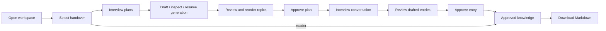

# Expert browser workspace

**Entry:** `/` on the FastAPI server, normally <http://localhost:8000/>.
**Outcome:** an expert reviews a plan, completes an interview, approves cited
entries and exports them. A reader can browse approved knowledge shared with
their identity.

The browser is a same-origin HTML/CSS/JavaScript client in `src/eki/web/static/`.
It uses the same authenticated API as other clients. It does not start ingestion
or mapping; those remain CLI setup steps.

## Prepare a handover

1. Run `uv sync` and `uv run eki migrate`. Ingest the selected synthetic sources,
   then run `uv run eki map --run RUN_ID`.
2. Assign the run to the intended token subject, for example
   `uv run eki access --run RUN_ID --owner nadia`.
3. Register a generated access token in `EKI_API_TOKENS`; the owner's record
   needs `subject: "nadia"` and the run expert's name for approvals. The
   [tutorial](../tutorial.md#step-9-use-the-runbook) shows the complete setup.
4. Start `uv run uvicorn eki.api.app:app --reload`. Restart the server after
   changing token registration or model configuration.
5. Open `/`, enter that registered access token, and choose **Open workspace**.
   Select the handover in the sidebar.

The token stays in tab memory. Refreshing requires sign-in again, followed by
selecting the same handover and conversation. Saved work comes from the server;
unsent answers are not persisted across a page reload.

## Walk through the workspace

| Area | Available actions |
| --- | --- |
| **Interview plans** | Draft a plan; inspect saved generation progress; resume unfinished topics; open an existing conversation. |
| Plan review | Read source quotations; move, remove or add topics; explicitly approve the completed plan. Partial generations cannot be approved. |
| Conversation | Save an answer; mark it confidential; skip; correct an earlier answer by its expert turn number. |
| Conversation recovery | Resume a saved receipt or recover an interrupted step without submitting its answer again. |
| **Review entries** | Inspect sections, citations, open questions and unsupported-term flags; read permitted source turns; edit, reject or approve. |
| **Approved knowledge** | Search, ask cited questions, open approved entries, download an entry or the handover as Markdown. |

Editing separates claims/steps with a blank line and returns the entry to draft.
Approval is a separate action. Rejection records a reason and keeps the entry
in review history while excluding it from readers, search and export.
Search/Q&A spans all permitted handovers; the entry list and bulk Markdown
export are scoped to the selected handover.

## Delivery and drafting recovery

Each logical browser submission gets a stable message ID. Retrying unchanged
content reuses it; changing the payload gets another ID. The server rejects
conflicting saved work and stale question targets. While a submission is in
flight, its input controls are disabled. A lost response triggers a receipt
check before deciding whether acceptance failed.

| Receipt state | Meaning |
| --- | --- |
| `saved` | The redacted protected turn and receipt committed; processing may not have started. |
| `processing` | The workflow is being driven toward its next question/end. |
| `needs_retry` | The answer is retained; reconnect/resume is needed to continue processing. |
| `processed` | A terminal question/done result was committed; runbook publication still requires approval. |

Reopen **Open conversation** and use **Resume saved answer** for outstanding
receipts. **Recover conversation** handles an interrupted step without an
outstanding receipt. A saved plan generation has its own progress and
**Resume saved generation** control; changing its inputs/configuration requires
a new generation. See [message delivery](message-delivery.md) and
[plan generation](draft-plan.md) for the server contracts.

## Access and HTTP endpoints

| Identity | Visible data and controls |
| --- | --- |
| Owner/admin | Accessible runs, plans/generations, sessions, receipts, draft/review data and approved entries; explicit review actions. |
| Reader | Shared runs and their approved entries, cited search/Q&A and approved Markdown; no interview, receipt or review access. |
| Unauthenticated visitor | Static sign-in page and public API documentation/health endpoint; no run data. |

Navigation metadata comes from `GET /runbook/identity`, `GET /runs`,
`GET /runs/{id}/plans`, `GET /runs/{id}/generations` and
`GET /runbook/entries?run_id=...`. Listings are capped at 200 records. Run-bound
management routes enforce owner/admin access; approved entry/search/export routes
apply reader ACLs. The UI relies on those server checks.

An empty workspace means no runs are accessible to the token subject, or none
have been ingested. A reader's workspace intentionally has only **Approved
knowledge**. Name-based approval validation still requires the token's `name`
to match the run expert. There is no separate user-account/login service.

Browser downloads fetch approved Markdown with the bearer header before creating
a local download. Answer text, credentials and queries are not placed in URLs
or browser persistent storage. Source/model text is rendered as text nodes;
the shell sets a Content Security Policy restricting scripts to its own origin.
The owner can expand permitted source turns during review; reader citations
remain references and do not grant transcript access.

## Verification status

`tests/test_browser.py` covers static serving, ACL-filtered navigation and the
synthetic plan/interview/correction/review/search/export HTTP workflow.
`node --test tests/browser_client.test.cjs` checks submission identity and SSE
failure handling using Node's built-in runner. Actual browser interaction,
visual layout and accessibility QA remain pending because browser control was
unavailable. Real-provider validation is deferred by user request.
