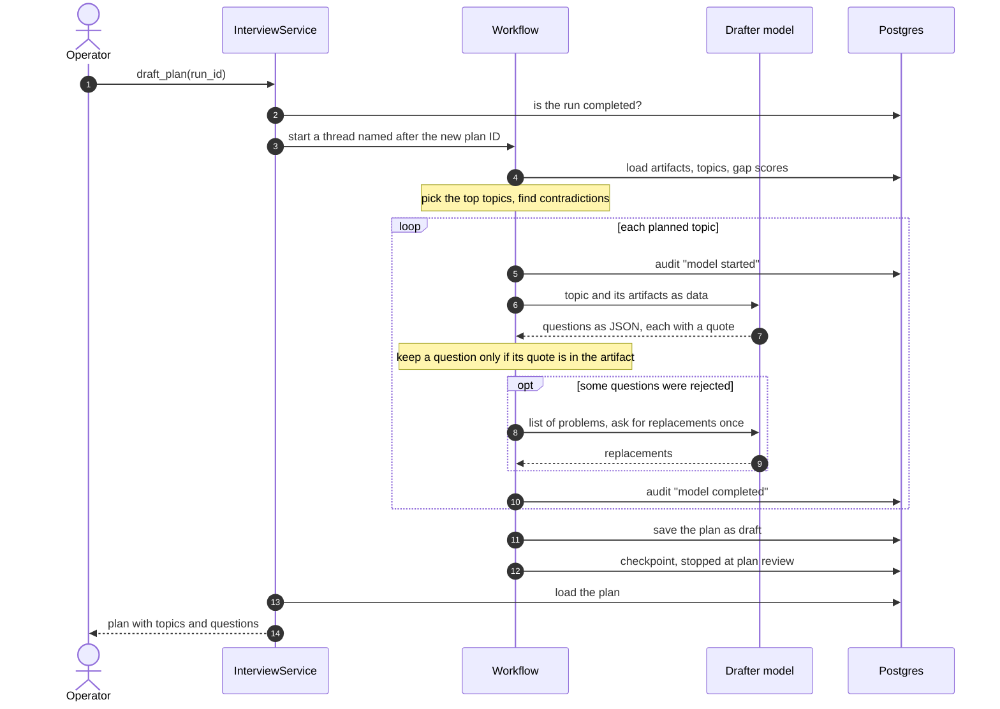

# Draft an interview plan

**Trigger:** `eki plan --run ID` (`src/eki/cli.py:280`) or `POST /runs/{id}/plan`
(`src/eki/api/app.py:366`)
**Outcome:** a draft `interview_plans` row holding the 10 highest-scoring
topics, plus any other topic whose sources contradict each other, with up to
5 drafted questions each; and a workflow stopped at the plan review.

## What happens

## Walkthrough

1. **Entry** - a new plan ID is generated; it is also the workflow's thread ID
   (`src/eki/interview/service.py:131`).
2. **Guard** - an unknown or unfinished run is refused before anything runs
   (`src/eki/interview/service.py:135`).
3. **Workflow** - this is the `draft_plan` node of the interview workflow
   (`src/eki/graph/workflow.py:131`).
4. **Inputs** - everything comes from the database. No source is read again.
5. **Topic choice is plain code** - topics are ranked by gap score and cut to
   the plan size, 10 by default. A topic below the cut is added anyway when
   its artifacts contradict each other (`src/eki/interview/plan.py:35`,
   `src/eki/interview/conflicts.py:62`).
6. **One model conversation per topic** (steps 5 to 10) - the model sees up to
   12 artifacts of the topic, already redacted, and must answer in JSON
   (`src/eki/interview/drafting.py:134`).
7. **Quotes are checked** (after step 7) - a question is kept only if it names a
   shown artifact and its quote appears in that artifact
   (`src/eki/interview/drafting.py:110`). This is what makes each question
   traceable to what prompted it.
8. **One retry** (steps 8 and 9) - rejected questions are sent back once with
   the reasons. What is still wrong after that is dropped and listed on the
   plan as `dropped` (`src/eki/interview/drafting.py:152`).
9. **Contradictions first** - a question about two artifacts that disagree is
   written by code, quoting both, and placed before the model's questions
   (`src/eki/graph/workflow.py:165`).
10. **Stop for review** (step 12) - the next node interrupts and waits for
    approval (`src/eki/graph/workflow.py:173`).

After this the expert can remove, add and reorder topics with
`PATCH /plans/{id}` (`src/eki/api/app.py:375`) until the plan is approved.
Approval freezes the plan, opens the session and asks the first question
(`src/eki/interview/service.py:184`); from there see
[interview-turn.md](interview-turn.md).

## Failure modes

| When | Behaviour | Where |
| --- | --- | --- |
| The run does not exist or is not completed | 404; nothing started | `src/eki/interview/service.py:135` |
| The run was never mapped | 409 "map it before planning"; the workflow thread is deleted | `src/eki/graph/workflow.py:138`, `src/eki/interview/service.py:145` |
| No drafter model configured | 503 from the API, exit code 2 from the CLI | `src/eki/config.py:68` |
| The model cannot be reached | 502; the workflow thread is deleted; **no plan is saved** | `src/eki/interview/service.py:148` |
| The model replies with something that is not the requested JSON, twice | that topic gets no model questions; the reason is listed as dropped | `src/eki/interview/drafting.py:156` |
| Audit storage is down | 503; the model is not called | `src/eki/audit.py:234` |

The plan is saved once, after the last topic (`src/eki/graph/workflow.py:168`).
If the model fails on topic 9 of 10, the questions already drafted for topics
1 to 8 are discarded and a retry pays for them again.

## Notes

- **A topic can end up with no questions.** The plan is still valid; the
  interviewer starts from the topic description alone.
- **The CLI cannot edit a plan.** `eki plan` prints the plan and
  `eki interview` approves it as it is. Pruning needs the API.
- **Every call to this trigger makes a new plan.** A run can have several
  plans; each approved plan has exactly one session.
