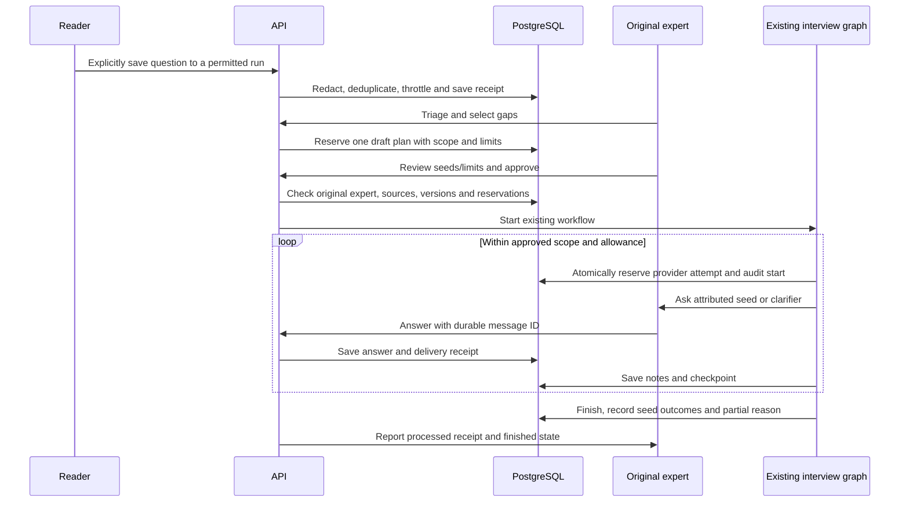

# Focused follow-up interviews

Phase 9a/9b implement explicit gap intake and a bounded return to the original
expert. Apply migrations through `0017_follow_up_sessions.sql` before using the
API. Preparation and review require no model configuration or provider calls.
Entry proposals and dedicated browser/CLI controls are the next deliverables.



Readers explicitly choose the destination run when saving a request with
`POST /runs/{id}/follow-up-requests`. The request UUID supports identical retries;
changed payloads conflict. `GET /follow-up-requests/{id}` exposes the requester's
safe receipt under live readership. Ordinary Ask does not save its question.

Owners/admins use `GET /runs/{id}/follow-up-gaps` and
`PATCH /runs/{id}/follow-up-gaps/{gap_id}` to map a request to an entry/section,
choose a deliberately new topic, edit the seed, group, defer or dismiss it.
Current public-open sections appear automatically; confidential source sections,
filled historical gaps and rejected entries are excluded. The queue includes
per-session attempt outcomes; readers cannot inspect it.

`POST /runs/{id}/follow-ups` accepts:

```json
{
  "request_id": "CLIENT_UUID",
  "parent_session_id": "FINISHED_CAPTURE_SESSION_UUID",
  "gap_ids": ["SELECTED_GAP_UUID"],
  "limits": {"topics": 3, "questions": 6, "model_calls": 12, "embedding_calls": 6}
}
```

The request ID becomes the plan ID. An identical retry returns the same plan even
when its questions have since been reviewed. Preparation reserves a single draft
per run immediately; remove its selections before preparing another. The parent
must be a finished capture interview in that run. Open-section sources and target
status/version are rechecked; requests need a target mapping or a new-topic choice.

Review uses the existing `GET/PATCH /plans/{id}` routes. Follow-up edits also accept
`seeds` (gap UUID to edited question), `remove_gaps`, `limits` and
`expected_revision`. Removed seeds release their reservations and narrow the scope.
The response includes the current revision. Plan approval can send that revision as
`expected_version`; a stale review conflicts. Approved plans are frozen.

Only the authenticated current owner whose name matches the original expert can
start or answer. A reader, a different same-name subject, an administrator who is
not that owner, or a disabled account cannot substitute. The session records its
respondent subject, checked again on writes and resume. Maintenance mode refuses
capture. A handover refuses active follow-ups and unsettled message receipts;
settled draft selections are released if ownership changes.

Interview messages and recovery use the existing session routes and message UUIDs.
The first question for each selected gap uses its approved text and ID. Clarifiers
retain that gap ID. Notes/open tools enforce section scope and bind to the actual
answered question. Covering one section does not satisfy another selected seed in
it. Public facts from different answers keep separate source turns. Confidential
text remains only in its flagged transcript turn and never enters model context,
traces or HTTP responses. A skip/unknown/confidential outcome leaves work unresolved.

Usage is returned on the session: questions, chat attempts, provider embedding
attempts, frozen limits, available chat token totals, duration, completion reason
and a partial flag. Provider reservations and audit starts commit together with a
shared call ID. Failed or uncertain attempts stay charged. Cached replies replay
without another chat allowance; a fresh HTTP service instance retains the counters.
Provider artifact queries use the recorded index/model pair and their own allowance;
local hashing spends no provider embedding allowance. No preparation reindexes data.

The question cap prevents asking question N+1 while allowing the Nth accepted answer
to be processed within the remaining chat allowance. Budget exhaustion closes the
graph deterministically. Accepted answers survive without pretending they became
notes. Closure commits before delivery becomes processed. `POST /sessions/{id}/stop`
refuses unsettled receipts; recover them first, then stop to retain the transcript
and return unresolved selections to triage. Stop retries are idempotent.

Finishing a deliberately new topic creates one private draft with cited public
facts and explicit remaining open sections. Finishing a mapped topic currently
retains private notes and leaves the existing published entry intact. Explicit
synthesis also refuses to duplicate that target. Phase 9c must add private proposals,
comparison/apply, authorized cross-session citations/corrections and publication-
linked resolution. Neither scheduling nor finishing resolves a gap. Browser and CLI
follow-up intake, scope/budget displays and proposal controls remain in Phase 9d.

Code: `eki.followup.gaps`, `eki.followup.sessions`, `eki.api.followup`,
`eki.interview.service`, `eki.interview.interviewer`, `eki.graph.workflow`.
Scripted evidence: `tests/test_follow_up_sessions.py` and
`tests/test_follow_up_recovery.py`; no paid providers are required.
