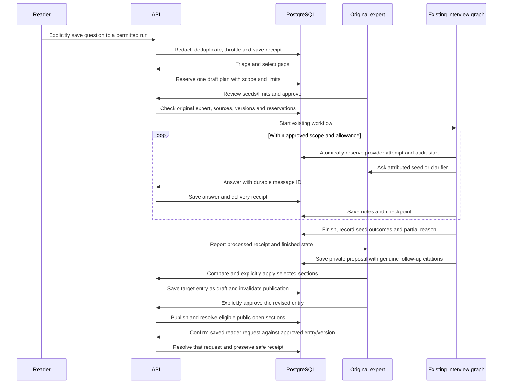

# Focused follow-up interviews

Phase 9 implements explicit gap intake, a bounded return to the original expert,
private entry proposals and explicit publication. Apply all migrations, including
`0018_follow_up_proposals.sql`, before using the API. Preparation, comparison and
review require no model configuration or provider calls.



Readers explicitly choose the destination run when saving a request with
`POST /runs/{id}/follow-up-requests`. The request UUID supports identical retries;
changed payloads conflict. `GET /follow-up-requests/{id}` exposes the requester's
safe receipt under live readership. Ordinary Ask does not save its question.

Owners/admins use `GET /runs/{id}/follow-up-gaps` and
`PATCH /runs/{id}/follow-up-gaps/{gap_id}` to map a request to an entry/section,
choose a deliberately new topic, edit the seed, group, defer or dismiss it.
Current public-open sections appear automatically; confidential source sections,
filled historical gaps and rejected entries are excluded. The queue includes
per-session attempt outcomes; readers cannot inspect it.

`POST /runs/{id}/follow-ups` accepts:

```json
{
  "request_id": "CLIENT_UUID",
  "parent_session_id": "FINISHED_CAPTURE_SESSION_UUID",
  "gap_ids": ["SELECTED_GAP_UUID"],
  "limits": {"topics": 3, "questions": 6, "model_calls": 12, "embedding_calls": 6}
}
```

The request ID becomes the plan ID. An identical retry returns the same plan even
when its questions have since been reviewed. Preparation reserves a single draft
per run immediately; remove its selections before preparing another. The parent
must be a finished capture interview in that run. Open-section sources and target
status/version are rechecked; requests need a target mapping or a new-topic choice.

Review uses the existing `GET/PATCH /plans/{id}` routes. Follow-up edits also accept
`seeds` (gap UUID to edited question), `remove_gaps`, `limits` and
`expected_revision`. Removed seeds release their reservations and narrow the scope.
The response includes the current revision. Plan approval can send that revision as
`expected_revision`; a stale review conflicts. Approved plans are frozen.

Only the authenticated current owner whose name matches the original expert can
start or answer. A reader, a different same-name subject, an administrator who is
not that owner, or a disabled account cannot substitute. The session records its
respondent subject, checked again on writes and resume. Maintenance mode refuses
capture. A handover refuses active follow-ups and unsettled message receipts;
settled draft selections are released if ownership changes.

Interview messages and recovery use the existing session routes and message UUIDs.
The first question for each selected gap uses its approved text and ID. Clarifiers
retain that gap ID. Notes/open tools enforce section scope and bind to the actual
answered question. Covering one section does not satisfy another selected seed in
it. Public facts from different answers keep separate source turns. Confidential
text remains only in its flagged transcript turn and never enters model context,
traces or HTTP responses. A skip/unknown/confidential outcome leaves work unresolved.

Usage is returned on the session: questions, chat attempts, provider embedding
attempts, frozen limits, available chat token totals, duration, completion reason
and a partial flag. Provider reservations and audit starts commit together with a
shared call ID. Failed or uncertain attempts stay charged. Cached replies replay
without another chat allowance; a fresh HTTP service instance retains the counters.
Provider artifact queries use the recorded index/model pair and their own allowance;
local hashing spends no provider embedding allowance. No preparation reindexes data.

The question cap prevents asking question N+1 while allowing the Nth accepted answer
to be processed within the remaining chat allowance. Budget exhaustion closes the
graph deterministically. Accepted answers survive without pretending they became
notes. Closure commits before delivery becomes processed. `POST /sessions/{id}/stop`
refuses unsettled receipts; recover them first, then stop to retain the transcript
and return unresolved selections to triage. Stop retries are idempotent.

Finishing a deliberately new topic creates one private draft with cited public
facts and explicit remaining open sections. Finishing a mapped topic creates one
idempotent private proposal and leaves the existing published entry intact. Explicit
synthesis refuses to duplicate the target. `GET /sessions/{id}/follow-up-proposals`
compares the current and proposed sections against the recorded base version,
source gaps, citations and advisory unsupported terms.

`POST /follow-up-proposals/{id}/apply` accepts selected section modes (`merge` or
`replace`), `expected_revision` and `expected_version`. It locks and validates the
target and proposal, preserves unrelated sections, updates the same entry ID to
draft, clears approval and invalidates its search index atomically. Identical
retries return the applied result; changed payloads or versions conflict. A stale
comparison can be explicitly refreshed with
`POST /follow-up-proposals/{id}/refresh`; inspect its new revision before applying.
Ordinary re-synthesis preserves the applied facts. Separate ordinary entry approval
revalidates all sources and makes the revised entry searchable/exportable.

Every interview citation keeps its actual session ID and ordinal. Only explicitly
linked follow-up topics may supply public expert turns to an existing entry. The
owner can expand those sources through the normal permitted session route; readers
receive references without transcript access. Correcting a linked answer updates
dependent entries/proposals, returns published content to draft and invalidates its
index in the same transaction. Faithfulness checks resolve session and ordinal
together, so equal turn numbers in different interviews cannot collide.

Neither scheduling, finishing nor applying resolves a gap. Explicit approval closes
tracked public open-section gaps only when that section contains public cited facts
and has no remaining open question. Saved reader requests require explicit reviewer
confirmation via `POST /runs/{run_id}/follow-up-gaps/{gap_id}/resolve`:

```json
{
  "expected_revision": 3,
  "entry_id": "APPROVED_ENTRY_UUID",
  "expected_version": 5,
  "confirms_answer": true
}
```

The entry must be approved, current and in the same run. The requester sees their
safe updated receipt under live access. Reopening retains history and returns the
request to triage; reopening a resolved entry section makes it a current candidate.
Unknown, skipped, confidential and unattempted seeds remain unresolved.

## Browser and CLI

In **Approved knowledge**, an unsupported Ask result offers **Save for a follow-up**.
Choose the destination handover explicitly; the confirmation identifies its owner.
A save creates a request, not an appointment or a promise of an answer. Changed
evidence, context limits and overdue knowledge have distinct messages; overdue
knowledge points to maintenance review.

Owners use **Follow-ups** to map/group/defer/dismiss gaps, select a finished capture
interview, prepare the plan and inspect its seeds and limits. Only the original
expert/current capture owner may approve and answer it. The interview shows its
selected sections, durable usage, partial outcomes and stop control. Completion
opens unpublished proposal comparison; apply leads to the original target's entry
review. A saved reader request is confirmed separately after approval.

All `eki follow-up` commands require the caller's registered `EKI_API_TOKEN`,
including inspection and preparation. They use the same services and do not bypass
participant checks with a reviewer name:

```bash
uv run eki follow-up gaps --run RUN_ID
uv run eki follow-up plan --run RUN_ID --parent-session SESSION_ID --gap GAP_ID \
  --max-questions 6 --max-model-calls 12 --max-embedding-calls 6
uv run eki interview --plan FOLLOW_UP_PLAN_ID
uv run eki follow-up proposals --session FOLLOW_UP_SESSION_ID
uv run eki follow-up --help
```

Inspection prints IDs and revisions for explicit review/retry. Use the relevant
subcommand's `--help` for triage, plan edits/discard, comparison/apply/refresh,
reader request receipts, resolution and stop. The ordinary entry review remains
the separate publication decision. No command sends invitations or messages.

Code: `eki.followup.gaps`, `eki.followup.sessions`, `eki.followup.proposals`, `eki.api.followup`,
`eki.interview.service`, `eki.interview.interviewer`, `eki.graph.workflow`.
Scripted evidence includes the gap/session/recovery/proposal/resolution/CLI tests,
frontend follow-up browser cases and `tests/test_follow_up_browser.py`, which uses
the built workspace, real cookie-authenticated FastAPI routes and a throwaway
Postgres schema. The optional latter test needs frontend development dependencies
and a Playwright browser; no paid providers are required.
