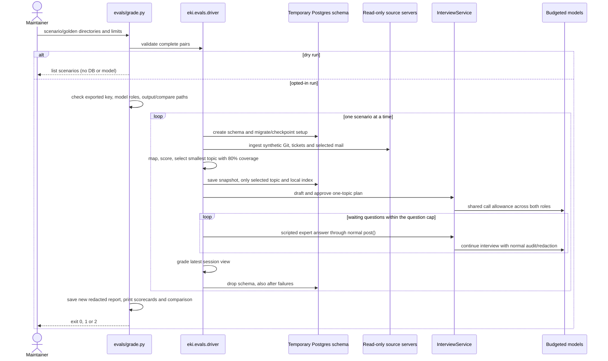

# Grade golden interviews

Trigger: `uv run python evals/grade.py`. This developer tool measures interview
behaviour on synthetic scenarios; it is separate from the CI quality gate.
The [Phase 7 PDR](../plans/phase-7.md) defines the contract and
[evals/README.md](../../evals/README.md) documents the file formats.

`load_pairs()` rejects unknown keys/sections, unmatched files, mismatched file
names and corpus paths outside the repository. `--only` filters validated pairs.
Draft inputs live under `docs/plans/phase-7-drafts/`; only the owner adopts them
into the default human-owned directories.

The runner selects synthetic `Inbox`, `Sent` and `Vendors` folders explicitly.
Mail exclusions and all source redaction run normally. Only the selected topic
and its score are mapped into the run; other topics cannot enter the plan.
Ingestion uses an audit context bound to the temporary schema, and service model
and tool calls retain their normal audit path. No entries are published.

A `CallBudget` is shared by both models. The first N calls reach the provider;
call N+1 raises `ModelError` without reaching it. Because the service can turn a
model error into a stream event, the driver also checks the shared budget's
stopped flag. A budget stop is reported as aborted, retains the available
transcript, and does not prevent subsequent scenarios from running. Other
exceptions record their type rather than potentially sensitive provider text.
The service's normal per-topic limits remain active; its question limit is
reduced if the scenario's cap is smaller.

The runner creates a local migration-history table before migrating and sets
up checkpoints without the public schema on the search path. This prevents
existing public tables from being reused. The schema is dropped in a `finally`
block, including when migration or interview work fails. A database outage can
prevent cleanup; the report then records the database exception type, and an
operator may need to remove the leftover `eki_eval_*` schema after recovery.

`grade()` reads the view and golden only. It excludes superseded notes and other
topics, and never treats confidential turns as grounding. Finished status plus
all seven checks determine the pass state. Phrase and word matching are
lexical, not semantic; a paraphrase can fail and a wrong claim using the expert's
words can pass.

The report holds an allowlist of settings and usage, redacted session content
and redacted check details. It excludes DSNs, credential values and exception
messages. The CLI writes a new path under `reports/` and refuses overwrites.
Comparison covers the union of scenario IDs: a previously passing scenario
that fails or is absent now is a regression. Missing scenarios are printed
explicitly. The exit code is 1 for any failed scenario or regression, 2 for an
input/guard error, and 0 otherwise. No paid evaluation has been recorded yet.
