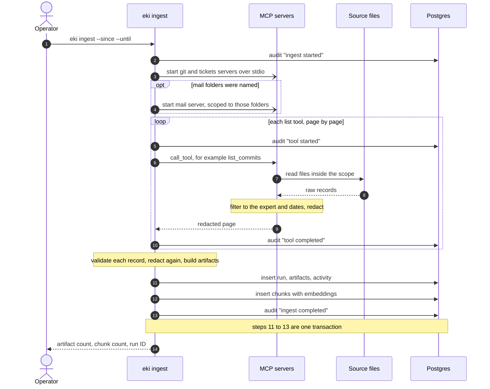

# Ingest one expert's work

**Trigger:** `eki ingest --since D --until D [--mail-folder F ...]` (`src/eki/cli.py:161`)
**Outcome:** one completed `ingest_runs` row with its redacted `artifacts`,
`activity` summaries and embedded `chunks`, and a run ID printed for the next
commands.

## What happens

## Walkthrough

1. **Scope** - the expert, the date range, the work email domains and any mail
   folders become a `Scope`. `--until` is extended to the end of that day
   (`src/eki/cli.py:170`). Mail folder names are validated here; an invalid one
   stops the command before anything starts (`src/eki/cli.py:179`).
2. **Audit first** - the start event is written on its own connection, so it
   survives if the ingest later fails (`src/eki/cli.py:184`).
3. **Servers** - each source is a separate subprocess speaking MCP over stdio.
   The scope is passed on the command line and is fixed for the life of the
   server; no tool can widen it (`src/eki/ingest/pipeline.py:399`).
4. **Mail is opt-in** - the mail server is started only when folders were named
   (`src/eki/ingest/pipeline.py:430`). Without them no mail is read.
5. **Audit per call** (steps 5 and 10) - every MCP call is recorded before and
   after, by tool name only (`src/eki/ingest/pipeline.py:85`).
6. **Pull** - commits, pull requests, wiki documents, repository and path
   activity, tickets and ticket activity, then mail if enabled
   (`src/eki/ingest/pipeline.py:304`).
7. **Scoped reads** - servers read only inside their allowed directories;
   paths that escape them, including through a symlink, are refused
   (`mcp_servers/common/source.py:39`).
8. **Redaction in the server** (before step 9) - text is redacted before it leaves the
   server, so unredacted text never crosses the process boundary
   (`mcp_servers/common/source.py:77`).
9. **Redaction again in the client** (after step 10) - the client does not trust the
   server: it validates the shape of every record
   (`src/eki/ingest/pipeline.py:106`) and redacts every text field again
   (`src/eki/ingest/pipeline.py:71`).
10. **One transaction** (steps 11 to 13) - the run, its artifacts, its index
    and the completion event commit together (`src/eki/cli.py:187`). A run is
    either complete or absent.

## Failure modes

| When | Behaviour | Where |
| --- | --- | --- |
| No expert or source directory configured | exit code 2, nothing started | `src/eki/cli.py:166` |
| A tool call fails or returns an error | `IngestError` naming the tool and the error type only; nothing stored; audit "tool failed" and "ingest failed" | `src/eki/ingest/pipeline.py:92`, `src/eki/cli.py:197` |
| A record has an unexpected shape | `IngestError`; nothing stored | `src/eki/ingest/pipeline.py:106` |
| Mail server returns the same message twice | `IngestError`; nothing stored | `src/eki/ingest/pipeline.py:329` |
| The database write fails | transaction rolled back; error names the exception type only | `src/eki/ingest/pipeline.py:500` |
| Audit storage is down | the command is refused before any source is read | `src/eki/cli.py:184` |

A failed ingest leaves audit events ("started", "failed") but no run. The run
ID in those events refers to a run that does not exist.

## Notes

- **The artifact index is not semantic.** Ingest always embeds with the local
  `HashingEmbedder` (`src/eki/cli.py:189`), whatever `EKI_MODEL_EMBEDDING` is
  set to. That setting applies to runbook search only. The interviewer's
  `search_artifacts` tool therefore matches on shared words.
- **Each ingest is a new run.** Nothing is updated in place; ingesting again
  produces a second, independent run.
- **Mapping is a separate command.** `eki map --run ID` loads the stored run,
  builds topics and gap scores in memory and saves them
  (`src/eki/cli.py:206`). It reads no source and calls no model, so it has no
  flow page.
