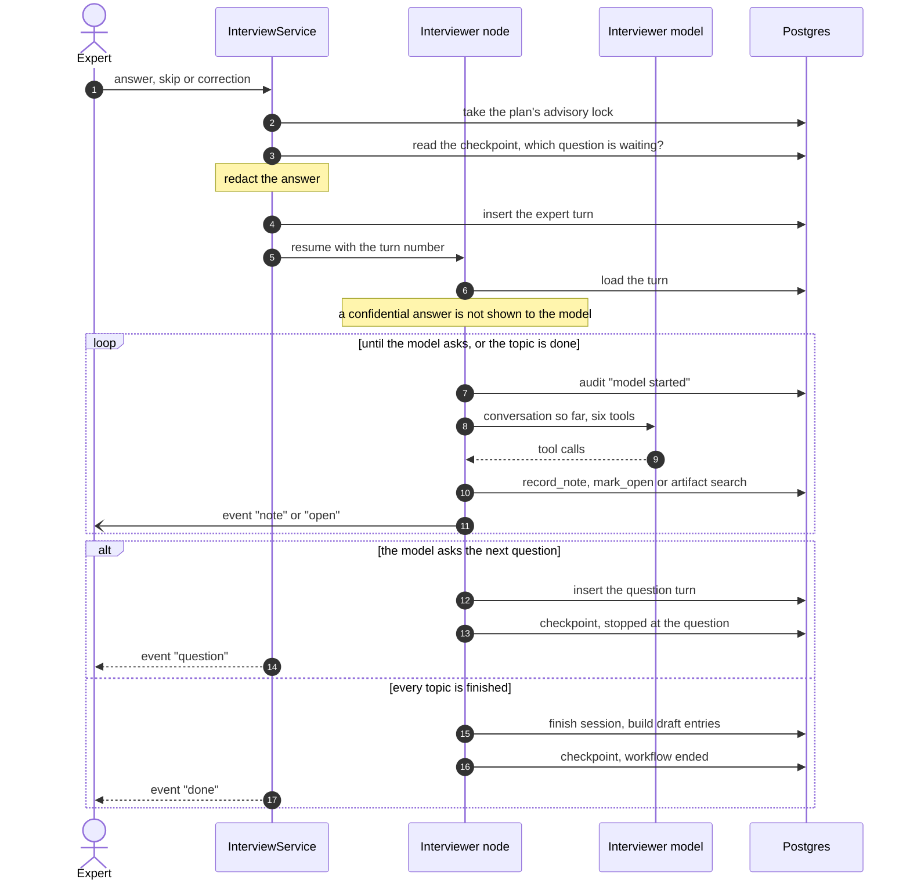

# One interview turn

**Trigger:** `POST /sessions/{id}/messages` (`src/eki/api/app.py:406`), or a
line typed in `eki interview --plan ID` (`src/eki/cli.py:332`)
**Outcome:** the expert's answer stored as a turn, notes or open items for the
sections it covered, and either the next question or, after the last topic, a
finished session with draft runbook entries.

This flow repeats once per answer. Everything between two answers is one step
of the workflow.

## What happens

## Walkthrough

1. **Three actions** - `answer`, `skip` and `correct`. Over HTTP the reply is a
   server-sent event stream; the CLI prints the same events
   (`src/eki/interview/service.py:232`).
2. **One message at a time** - an advisory lock on the plan is held for the
   whole step. A second message for the same session is refused, not queued
   (`src/eki/interview/service.py:251`).
3. **The checkpoint says what is waiting** - the question is read from the
   workflow's saved state, not from the request
   (`src/eki/interview/service.py:259`).
4. **Redaction before storage** - the answer is redacted before it is written
   anywhere (`src/eki/interview/service.py:303`).
5. **The answer is stored before the model runs** - and the insert is keyed by
   the question it answers, so a retry rewrites the same row
   (`src/eki/interview/store.py:224`).
6. **Resume carries a number, not the text** - the workflow gets only the turn
   number and reads the turn from the table
   (`src/eki/interview/service.py:316`, `src/eki/interview/interviewer.py:160`).
   Answer text never enters workflow state this way; a confidential answer
   therefore cannot leak into a checkpoint.
7. **Confidential answers** (after step 6) - the section is recorded as answered with
   a fixed marker, and the model is told only that
   (`src/eki/interview/interviewer.py:196`).
8. **The model works through tools** (steps 7 to 11) - each reply is a set of
   tool calls. Model text and tool arguments are redacted before they are kept
   (`src/eki/interview/interviewer.py:246`). Every tool call is audited before
   and after (`src/eki/interview/interviewer.py:264`).
9. **A note needs an answer** - `record_note` is refused until the expert has
   said something about this topic, and the note cites that turn
   (`src/eki/interview/interviewer.py:383`).
10. **Asking stops the step** (steps 12 to 14) - `ask_expert` stores the
    question and the node returns; on its next run it interrupts at the very
    top and waits (`src/eki/interview/interviewer.py:316`,
    `src/eki/interview/interviewer.py:425`). Tool calls after the question in
    the same reply are not run.
11. **Topic end is checked by code** - the `check_complete` node sends the
    model back if a section has neither a note nor an open item
    (`src/eki/graph/workflow.py:215`).
12. **Last topic** (steps 15 to 17) - the session is marked finished and one
    draft entry per topic is built from the notes, in one transaction, with no
    model call (`src/eki/graph/workflow.py:227`,
    `src/eki/runbook/service.py:54`).

**Skip:** the section is recorded as open with the reason "skipped by expert"
and the model is told not to ask again (`src/eki/interview/interviewer.py:174`).

**Correction:** the correction is stored as a new turn, every note taken from
the corrected turn is replaced by the correction word for word, and any runbook
entry citing that turn is updated and returned to draft, all in one transaction
(`src/eki/interview/service.py:318`). The pending question stays open.

## Failure modes

| When | Behaviour | Where |
| --- | --- | --- |
| Another message for the session is in progress | 409; nothing stored | `src/eki/interview/service.py:251` |
| An answer with no text | 422; nothing stored | `src/eki/interview/service.py:301` |
| The interview is already finished | 409 (a correction is still accepted) | `src/eki/interview/service.py:293` |
| The model cannot be reached | event `error` / `model_unavailable`. The answer is already stored; sending the message again continues | `src/eki/interview/service.py:394` |
| Audit storage is down | event `error` / `audit_unavailable`; the model is not called; the session can be retried | `src/eki/interview/service.py:387` |
| The process stopped in the middle of a step | the next message gets event `recovered` and the step is re-run. **The text of that message is not used** | `src/eki/interview/service.py:294`, `src/eki/interview/service.py:371` |
| 12 questions asked about one topic | the remaining sections are marked open and the topic ends | `src/eki/interview/interviewer.py:310` |
| 40 model calls spent on one topic | same, with the reason "the interviewer stopped" | `src/eki/interview/interviewer.py:436` |
| The model replies with plain text and no tool call | it is told to use a tool; this counts towards the 40 calls | `src/eki/interview/interviewer.py:252` |

## Notes

- **A retry with different text replaces the stored answer.** The insert in
  step 4 updates the existing row when the same question is answered again
  (`src/eki/interview/store.py:243`). After a model failure, what the expert
  sends the second time is what the transcript keeps.
- **A step is re-run from its start after a failure.** Model calls made before
  the failure are made again and audited again as separate attempts. The
  question turn is rewritten in place; a note recorded twice supersedes the
  first, which is kept but no longer in force.
- **The interviewer's artifact search is lexical**, see
  [ingest.md](ingest.md).
- **The notes are the model's wording.** They are compared with the cited
  answer only later, at review; see [review-entry.md](review-entry.md).
