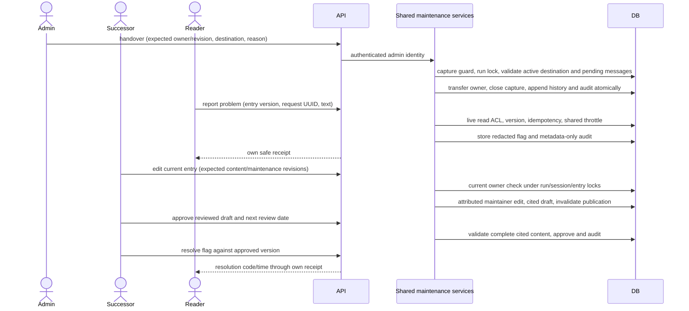

# Maintain knowledge after the expert leaves

Phase 8 (F21) adds successor responsibility, review deadlines and private reader
feedback. The [Phase 8 PDR](../plans/phase-8.md) defines its acceptance contract.
Apply migrations 0013–0015 with `uv run eki migrate` before running the updated API.



## Handover and authority

The original expert and source identity stay unchanged. `owner_subject` is the
single current owner. `maintenance_started_at` marks the explicit transition
from capture; a run revision protects transfers from stale clients.

Only an administrator or trusted local operator transfers responsibility. The
destination is an active account or configured bearer identity. New capture
work, plan changes/approval, answers and transcript corrections are closed once
maintenance begins. Existing accepted message receipts must be recovered before
handover; a shared capture advisory lock also prevents transfer during live work.
No answer is discarded, no draft is published, no deadline is renewed and no
flag is resolved by a transfer. Disabling the old account remains a separate
operator decision because the account may own other runs.

In maintenance, entry edit/approve/reject/review/withdraw and flag resolution
require the live owner subject. A former owner or an administrator who is not
that owner cannot approve by supplying the expert's name. Administrators can
explicitly assign themselves responsibility. Service transactions recheck the
owner after locking the run; middleware alone does not authorize a write.

Successor edits are public human turns of `speaker=maintainer`, `kind=edit`,
with subject/name attribution. Their claims retain genuine turn citations and
show the maintainer label in the browser/export. Original expert turns remain
unchanged. Historical authorized maintainer evidence stays valid after another
transfer. Confidential, corrected, skipped and unrelated-topic sources remain
ineligible. A confidential answer is never exposed through maintenance.

## Review lifecycle

Publication remains `draft`, `approved` or `rejected`. Freshness is computed
from an inclusive UTC `review_by` date: current, due soon within 14 days, or
overdue after that day. New approval and an explicit unchanged-content review
use 90 days by default; a chosen date must be tomorrow through 365 days ahead.
A date cannot be postponed by an ordinary metadata patch.

An unchanged review validates the approved version and sources and records its
actor, reviewed version and next deadline. Original approval, claims, citations
and content version stay intact. Metadata revisions increase on review and
feedback changes. The index invalidation trigger only reacts to content,
title, publication or content-version changes; routine maintenance does not
spend another embedding call.

Overdue approved entries remain in detail, search and Markdown with labels.
Q&A filters them out before either candidate ranking channel and provider
context. It checks live approval, version, ACL and freshness again after model
latency, including UTC midnight crossings. Matching overdue material produces
a safe review-needed explanation. Flags alone do not suppress knowledge.
Owners can withdraw suspect content to draft with a reason; re-publication
requires approval. Editing and withdrawal invalidate the published index.

Migration backfills old approved entries from their actual approval time plus
90 days, without inventing reviewer subjects or changing historical content.
Some old entries therefore become overdue immediately. Review them through the
queue before expecting Q&A to use them again. There is no scheduled expiry job.

## Reader reports

Readers report only a currently accessible approved version. A request UUID
makes retries idempotent; changed replay payloads and stale entry versions
conflict. Redaction precedes persistence. Reports are plain untrusted text,
never indexed, cited as facts or sent to a model. A shared Postgres throttle
allows ten new reports per minute per subject; identical retries are free.

Readers see their own receipts while they retain run readership, including
while the entry is draft. Receipts contain their submitted text/observed version
and resolution code/time, not private resolution notes, the new draft version,
other reporters or interview content. Owner/admin triage views remain private.

The owner resolves reports explicitly:

- **Corrected:** requires a content edit (or transcript correction) recorded after
  the report, then a later approved version. Withdrawing and re-approving
  unchanged content raises the version but does not count as a correction.
- **Confirmed current:** requires an unchanged review of this approved version
  performed after the report. A decision cursor enforces order even when two
  events have the same timestamp.
- **Dismissed:** requires a private reason and does not renew the deadline.

Resolution is immutable. Editing, approving, reviewing and transferring never
silently close a report. Queue rows and triage show observed/current versions.
Audit contains actor/target IDs, operations and versions, never report bodies
or reasons. Audit failure rolls back report, throttle and metadata writes.

## Operation

```bash
uv run eki migrate
uv run eki maintenance --run RUN_ID                    # state, run revision, queue
uv run eki maintenance --run RUN_ID --filter overdue
uv run eki maintenance --run RUN_ID --filter flagged --offset 50
uv run eki handover --run RUN_ID --to samir \
  --expected-owner nadia --expected-run-revision REVISION --reason "Expert departure"
# For an unassigned run, use --unassigned instead of --expected-owner.
uv run eki maintenance --run RUN_ID --filter due        # overdue or due within 14 days
uv run eki review --run RUN_ID --due                    # overdue + due soon; requires the reviewer's EKI_API_TOKEN
uv run eki review --plan PLAN_ID --review-by 2027-02-01  # choose an appropriate future date
```

Register/provision the destination before transfer. Read-only CLI inspection,
account provisioning and handover retain the trusted local operator model.
CLI review mutations now require the registered reviewer's `EKI_API_TOKEN` and
live account/ownership checks; `--review-as` cannot impersonate someone else.
Use the browser account for cookie-authenticated review, or register a matching
bearer identity for CLI review. Models are unnecessary for all these actions.

HTTP routes: `GET /runs/{id}/maintenance`, its paginated `/entries` queue,
`POST /runs/{id}/handover`, entry `/review` and `/withdraw`, entry `/flags`
creation/listing, `/flags/{id}` receipts and entry `/flags/{id}/resolve`.
Existing owner routes/CLI share transfer validation/history and require expected
state once an owner is assigned. Existing entry review endpoints accept expected
content/maintenance revisions; maintenance writes require both. Cookies retain
Origin/CSRF checks and all authenticated responses are private/no-store.

The browser's **Maintenance** tab offers filters, handover for admins and entry
links. Entry detail offers next-review dates, unchanged review, withdrawal and
private flag triage; readers get report/receipt controls and freshness labels.
