# Review and approve a runbook entry

**Trigger:** `GET /entries/{id}` then `POST /entries/{id}/approve`
(`src/eki/api/app.py`, `src/eki/api/app.py`), or `eki review --plan ID`
(`src/eki/cli.py`)
**Outcome:** the entry's status becomes `approved` with a new version, a row
in `entry_decisions` and an audit event. From then on the entry is visible to
search, Q&A and export.

Draft entries already exist when this flow starts: they are built at the end
of the interview, see [interview-turn.md](interview-turn.md).

## What happens

```mermaid
sequenceDiagram
    autonumber
    actor Expert
    participant API as API and middleware
    participant Svc as RunbookService
    participant DB as Postgres

    Expert->>API: GET /entries/{id} with bearer token
    Note over API: token to identity, from EKI_API_TOKENS
    API->>DB: which run owns this entry, is the caller its owner?
    API->>Svc: get entry, history, unsupported claims
    Svc->>DB: load entry, decisions, session transcript
    Note over Svc: compare each claim with the turns it cites
    API-->>Expert: sections, citations, decisions, unsupported

    Expert->>API: POST /entries/{id}/approve {approved_by}
    Note over API: approved_by must equal the token's name
    API->>Svc: approve(entry_id, by)
    Svc->>DB: lock the session row, then the entry row
    Note over Svc: must be the run's expert, a draft, complete, fully cited
    Svc->>DB: check every citation is a public, uncorrected expert turn
    alt a check fails
        Svc-->>API: error, nothing written
        API-->>Expert: 409 or 422
    else all checks pass
        Svc->>DB: save entry as approved, version + 1
        Svc->>DB: insert decision and audit event
        Note over Svc,DB: steps 8 to 13 are one transaction
        API-->>Expert: approved entry
    end
```

## Walkthrough

1. **Authentication** (after step 1) - the bearer token is looked up in the
   credential registry from the environment; there is no user table
   (`src/eki/auth.py`).
2. **Authorisation** (step 2) - for every route under `/entries`, `/sessions`,
   `/plans` and `/runs`, the middleware resolves the resource to its run and
   requires the caller to be that run's owner or an admin
   (`src/eki/api/security.py`). The one exception: a reader of the run may
   `GET` an entry that is already approved (`src/eki/api/security.py`).
3. **Faithfulness check** (step 4) - the notes were worded by the
   interviewer model. For each claim, the cited turn and the question it
   answered are read, and the claim's words and numbers found in neither are
   listed (`src/eki/runbook/service.py`,
   `src/eki/runbook/faithfulness.py`). It is a word comparison with no
   model. It is advisory: it never blocks approval.
4. **Reviewer name** (after step 6) - the name in the request body must equal the
   name bound to the token (`src/eki/api/app.py`).
5. **Locks** (step 8) - session first, then entry, the same order as edits,
   corrections and synthesis, so they cannot interleave
   (`src/eki/runbook/service.py`).
6. **Approval rules** (after step 8) - the reviewer is the expert recorded on the
   run; the entry is a draft; no section is empty; every claim has a citation
   (`src/eki/runbook/review.py`).
7. **Source rules** (step 9) - each citation must point at a turn of this
   interview, said by the expert, about this topic, not confidential, not a
   skip and not since corrected (`src/eki/runbook/service.py`).
8. **Write** (steps 12 and 13) - the entry, the decision and the audit event
   commit together (`src/eki/runbook/service.py`,
   `src/eki/runbook/store.py`).

**Reject** follows the same path with a required reason
(`src/eki/runbook/service.py`).

**Edit** (`PATCH /entries/{id}`) replaces whole sections. The new text is
redacted and stored as an expert turn of kind `edit`, the new claims cite that
turn, and the entry returns to draft even if it was approved
(`src/eki/runbook/service.py`). An edited claim is its own source, so the
faithfulness check has nothing to report on it.

**In the browser** the **Review entries** tab uses these same endpoints.
Owners can expand permitted source turns, edit or reject drafts, approve entries
and download approved Markdown. Readers can read approved entries and citation
references, without transcript expansion or review controls. See
[browser-workspace.md](browser-workspace.md).

**In the CLI** there is no token. `eki review` acts as the expert recorded on
the run, or as `--review-as NAME`, and the same approval rules apply
(`src/eki/cli.py`).

## Failure modes

| When | Behaviour | Where |
| --- | --- | --- |
| No or unknown token | 401 | `src/eki/api/security.py` |
| Caller is not the owner or an admin | 404, the same as a missing entry | `src/eki/api/security.py` |
| `approved_by` differs from the token's name | 422; nothing written | `src/eki/api/app.py` |
| Reviewer is not the run's expert | 422; nothing written | `src/eki/runbook/review.py` |
| Entry is already approved or rejected | 409 "edit it first" | `src/eki/runbook/review.py` |
| A section is empty, or a claim has no citation | 422; nothing written | `src/eki/runbook/review.py`, `src/eki/runbook/models.py` |
| A claim cites a turn that has since been corrected | 422; nothing written | `src/eki/runbook/service.py` |

## Notes

- **Approval is tied to a display name, not to an account.** Both checks
  compare names: the token's `name` against the request, and the request
  against the run's `expert_name`. Any credential configured with the expert's
  name can approve, and `entry_decisions` stores the name. The audit event
  does record the token's stable subject.
- **The faithfulness result is not stored.** It is recomputed on every read
  from the current transcript. Readers never receive it
  (`src/eki/api/app.py`).
- **A correction to a cited answer reopens approval.** It replaces the claim
  text and returns the entry to draft (`src/eki/runbook/service.py`).
  Procedure text is split into the same ordered steps as synthesis, respecting
  abbreviations and explicit lists. Each step cites the correction turn;
  unrelated claims keep their text and citations (`src/eki/runbook/steps.py`).
- **Approved entries are indexed lazily**, on the next search; see
  [search-and-ask.md](search-and-ask.md).
