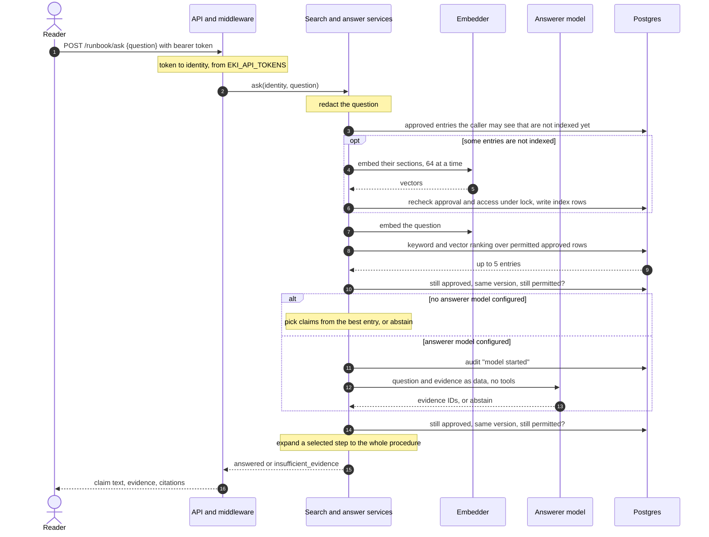

# Search the runbook and ask a question

**Trigger:** `POST /runbook/ask` (`src/eki/api/app.py:459`) or `eki ask "..."`.
Search alone is `GET /runbook/search?q=...` (`src/eki/api/app.py:452`) or
`eki search "..."`; it is steps 1 to 9 of this flow.
**Outcome:** an answer made of exact approved claims with their citations, or
`insufficient_evidence`. Nothing is written except the search index and audit
events.

## What happens

## Walkthrough

1. **Access is applied in SQL** - `/runbook` routes have no resource ID, so the
   middleware only authenticates (`src/eki/api/security.py:39`). Which runs the
   caller may see is a predicate inside every query: admin, owner or listed
   reader (`src/eki/access.py:14`).
2. **Redaction** (after step 2) - the question is redacted and must be 1 to 2000
   characters (`src/eki/search/service.py:88`).
3. **Lazy indexing** (steps 3 to 6) - every search first indexes any approved
   entry the caller may see that has no index rows for its current version and
   the configured embedder (`src/eki/search/index.py:16`).
4. **Provider work outside the transaction** (steps 4 and 6) - vectors are
   fetched first; then, under row locks, approval, version and access are
   checked again before the rows are replaced (`src/eki/search/index.py:57`).
   An entry is indexed completely or not at all.
5. **Hybrid ranking** (step 8) - one SQL statement. It filters to permitted,
   approved, current-version rows first, then ranks by full-text relevance and
   by cosine distance, takes each entry's best chunk per channel, and combines
   the two ranks by reciprocal rank fusion (`src/eki/search/service.py:116`).
6. **First freshness check** (step 10) - the hits are re-read; if any entry is
   no longer approved, changed version or is no longer permitted, the answer
   is `insufficient_evidence` (`src/eki/search/answers.py:139`).
7. **Default answer, no model** (after step 10) - claims are scored against the
   question; the best entry must share at least 60% of the question's topical
   words, otherwise the service abstains (`src/eki/search/answers.py:184`).
8. **Model-selected answer** (steps 11 to 13) - the model receives the question
   and bounded evidence and may only return IDs of that evidence or abstain.
   It writes no prose and has no tools. Unknown IDs, duplicates or a
   contradictory reply are rejected (`src/eki/search/answers.py:273`).
9. **Second freshness check** (step 14) - the same check again, because a
   model call takes time (`src/eki/search/answers.py:288`).
10. **Whole procedures** (after step 14) - if a step was selected, every step of
    that entry is returned in order; if any step did not fit the evidence
    budget, the service abstains rather than return a partial procedure
    (`src/eki/search/answers.py:292`).
11. **The answer is assembled by code** - exact claim text followed by its
    evidence ID (`src/eki/search/answers.py:324`).

## Failure modes

| When | Behaviour | Where |
| --- | --- | --- |
| No or unknown token | 401 | `src/eki/api/security.py:66` |
| Empty or over-long question | 422 | `src/eki/search/service.py:89` |
| Question has only common words | no hits; `insufficient_evidence` | `src/eki/search/service.py:97` |
| Embedding provider fails | 502; the entry being indexed keeps no partial rows | `src/eki/search/embedding.py:52` |
| Answerer returns invalid or made-up evidence IDs | 502; no answer | `src/eki/search/answers.py:286` |
| An entry changed while answering | `insufficient_evidence`, without open questions | `src/eki/search/answers.py:288` |
| Audit storage is down | 503 before any provider call. With no provider models configured, nothing is audited here and the request succeeds | `src/eki/audit.py:234` |

## Notes

- **The first search after approvals is slower**, and can fail on a provider
  error, because indexing happens on the search path. There is no background
  indexer.
- **Without `EKI_MODEL_EMBEDDING` the vector channel is not semantic.** The
  local hashing embedder matches shared words (`src/eki/search/embedding.py:75`).
- **The vector ranking is exact, not approximate.** `runbook_index` has a
  full-text index but no vector index; every permitted row is compared. That
  is correct under access filtering, and its cost grows with the number of
  approved sections.
- **Access changes take effect on the next request.** A request already past
  step 10 may have sent previously permitted evidence to the answerer.
- **Search and answers never read the interview transcript.** Citations are
  returned as references (session and turn number), not expanded.

> **Known issue:** `GET /runbook/search` carries the query in the URL. The
> query is redacted inside the service, but a web server's access log records
> request URLs, and no access-log configuration was found in this repository.
> A secret typed into a search can therefore reach the server log unredacted.
> `POST /runbook/ask` sends its question in the body and is not affected.
