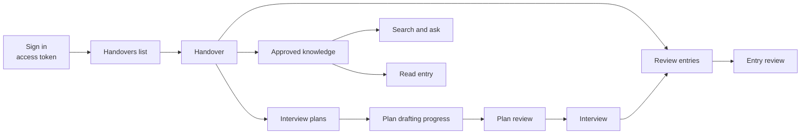

# eki browser workspace: UI definition

What the browser interface of `eki` must do, for whom, and within which limits.
It is the brief for designing the next version of the workspace and the yardstick
for accepting it. The design prompt in
[claude-design-prompt.md](claude-design-prompt.md) is derived from this document.

**Status:** implemented with automated coverage, 2026-11-14; manual screen-reader
walkthrough and real-provider validation remain pending.
**Covers:** requirement F16 (browser workflow for plan review, interview, cited
entry review and approval), and the browser side of F10, F11, F12 and F14.
**Starts from:** the existing workspace in `src/eki/web/static/` (commit
`d28c2b3`). It works end to end over HTTP but is a plain first version: one
JavaScript file, minimal layout, and no visual or accessibility QA yet
([browser-workspace.md](../flows/browser-workspace.md)).

## 1. Why a UI

The person at the centre of `eki` is an expert who is leaving: often senior, not
always technical, and short of time. Today they can only answer in a terminal or
through a plain page. The interview is a long conversation and review means
reading seven sections with sources and warnings per entry. Both deserve an
interface that is calm, clear about what happens to every answer, and quick to
resume after a break.

The interface must make the product's promise visible: **nothing is published
without the expert's approval, and every published statement shows where it
came from.**

## 2. Users and their jobs

| User | Who | Main jobs | Sees |
| --- | --- | --- | --- |
| **Expert** (owner of a handover) | The person leaving, e.g. "Nadia Ferrand" | Shape the interview plan; answer questions over several sittings; correct, skip or keep answers confidential; review, edit, approve or reject each entry | Everything about their own handovers |
| **Reader** | A colleague or successor | Find and read approved knowledge; ask a question and trust the answer's sources; download Markdown | Approved entries shared with them, nothing else |
| **Admin** | The person running `eki` | Same as owner on any handover | Everything |

Out of scope for the browser: ingesting sources, mapping gaps, assigning owners
and readers. These stay CLI steps done once by an operator (§9).

## 3. Design principles

1. **One thing at a time.** One question in the interview, one entry in review.
   The rest is reachable but quiet.
2. **Show the source.** Every claim carries its source; every drafted question
   shows the quote that prompted it. Provenance is part of the content, not a
   tooltip.
3. **The expert decides, visibly.** Approve, reject and edit are explicit,
   separate actions. Nothing changes state as a side effect of reading.
4. **Never lose an answer, and say so.** After each submission the UI shows that
   the answer is saved. Interruptions offer one clear way to continue.
5. **Honest about gaps.** "Not answered", "skipped", "confidential" and "the
   runbook does not cover this" are first-class states with their own design,
   not empty space.
6. **Calm and respectful.** This is someone's career knowledge, often at the end
   of their tenure. The tone is warm, plain and unhurried. No gamification.

## 4. Information architecture

Readers see only **Handovers list → Approved knowledge**. The tabs **Interview
plans** and **Review entries** do not exist for them, rather than being shown
disabled.

## 5. Screens

Each screen lists its purpose, content, actions and the states it must design.
API calls are in §8.

### 5.1 Sign in

- **Purpose:** open the workspace with an access token.
- **Content:** one password-style field, one button, a line explaining that the
  token stays in this tab only and a refresh needs it again.
- **States:** empty; submitting; wrong token (401); server not configured (503).

### 5.2 Handovers list (sidebar or home)

- **Content per handover:** expert name, date range of the work covered, whether
  the user manages it or only reads it.
- **States:** none accessible (explain: none shared, or none prepared yet);
  more than ~10 handovers (the API returns at most 200).

### 5.3 Interview plans

- **Content:** each plan with its status: *drafting*, *ready for review*,
  *interview in progress*, *interview finished*. A plan has at most one
  conversation.
- **Actions:** draft a new plan; open a plan; resume an unfinished drafting;
  open the conversation.
- **Drafting progress:** drafting runs topic by topic with a model and can take
  minutes. Show saved/total topics, and on failure "N of M topics drafted, resume
  to continue". A partially drafted plan cannot be approved.

### 5.4 Plan review

- **Content per topic:** title; kind (procedure, incident, system, decision,
  contact) and system name; why it is in the plan, either a gap score (0–100) or
  "its sources contradict each other"; drafted questions, each with the artifact
  ID and the exact quote it came from; questions that were dropped, with reason.
- **Actions:** reorder topics (drag and keyboard alternative); remove a topic;
  add a topic (name plus a note in the expert's words); approve the plan.
- **Rules:** approval freezes the plan and opens the interview; confirm before
  approving. Approval is refused if the signed-in name is not the handover's
  expert: say so plainly.
- **States:** a topic with no drafted questions; contradiction topics, which
  should stand out because they will be asked first.

### 5.5 Interview (the core screen)

- **Layout:** the current question large and central, with the answer box under
  it. Around it, quieter: the topic name and "topic 2 of 4", the seven-section
  checklist of the current topic, and the transcript so far.
- **The seven sections**, each with status *missing*, *noted*, *left open* or
  *confidential*: trigger, diagnosis, steps, rollback, contacts, pitfalls,
  rationale.
- **Actions:**
  - **Answer:** free text, multi-line. For steps, hint "one step per sentence or
    line".
  - **Mark confidential:** a toggle on the answer. Explain before sending: the
    answer is stored but never sent to the AI, never shown to readers, and the
    runbook says only "answered confidentially".
  - **Skip:** leaves that section open; the interviewer will not ask again.
  - **Correct an earlier answer:** pick it from the transcript, rather than
    typing a turn number; the old and new text are both visible.
  - **Pause:** leaving is always safe; say so.
- **Feedback after each answer:** stream what the interviewer did: "Noted for
  steps: …", "Left open: rollback (skipped)". The note text is what will appear
  in the runbook, so show it in full.
- **States:**
  - waiting for the next question (seconds to tens of seconds with a real model);
  - answer saved but processing interrupted, or a lost response: show "Your
    answer is saved" and one **Continue** action (receipt states in §7);
  - model unreachable: "Nothing was lost. Try again.";
  - audit storage unavailable: the same, with a different explanation;
  - topic finished, moving to the next;
  - interview finished: summary of sections noted and left open, and a link to
    review.

### 5.6 Review entries

- **List:** one row per entry: title, status (draft, approved, rejected),
  "edited by hand", "N claims to check", version.
- **Entry view:** seven sections in order. A section shows its claims, or its
  open question with the reason. Steps are numbered. Each claim shows its source
  ("interview, turn 6"); the owner can expand it to read that turn. A claim
  flagged by the faithfulness check shows the words not found in the cited
  answer, e.g. "not in the cited answer: 15, minutes".
- **Actions:** approve; reject with a required reason; edit sections (claims, or
  an open question when there are no claims); see decision history.
- **Rules:** edit returns an approved entry to draft. Approval requires that
  every section has a claim or an open question and that every claim is cited;
  explain a refusal in those terms.
- **States:** confidential section; skipped section; an entry reopened because a
  cited answer was corrected.

### 5.7 Approved knowledge (owner and reader)

- **Search:** a query box; results show entry title, the section that matched,
  a snippet and its sources.
- **Ask:** a question box; the answer is a list of exact approved claims with
  numbered evidence (entry, section, version). Full procedures are returned in
  order. When there is no answer: "The approved runbook does not cover this
  yet", with search suggested.
- **Read entry:** the approved entry, approver and date, version, sources as
  references.
- **Download:** one entry, or the whole handover, as Markdown.
- **States:** nothing approved yet; no results.

### 5.8 Global

- Header with signed-in name and **Sign out**.
- A live status region for notices.
- An error state for session expiry (token rejected mid-use) that returns to
  sign-in without losing the place where possible.

## 6. Content and tone

- Plain words, short sentences. "Handover" for a run, "conversation" or
  "interview" for a session, "entry" for a runbook entry.
- Avoid internal terms in the UI: no "run", "artifact", "ordinal", "receipt",
  "generation", "checkpoint". Show IDs only where a user needs to quote one.
- Existing voice to keep: "Keep the knowledge. Honour the source.", "A
  thoughtful handover. A lasting reference."
- Error messages say what happened, whether anything was lost, and the one next
  step.

## 7. Behaviour rules that the design must respect

| Rule | Why | Design consequence |
| --- | --- | --- |
| The token lives only in tab memory | No credential in storage | Refresh shows sign-in; say this on the sign-in screen |
| No answer, query or token in a URL | URLs reach server logs | Search and ask are forms, never shareable query links |
| Confidential text is never displayed after sending | Privacy rule of the project | Transcript shows "[confidential]" in place of the text |
| Readers never see drafts, transcripts or review history | Access rule | Reader layout has no such areas |
| Each submission has a stable ID; retries reuse it | No duplicate answers | While sending, disable the input; on a lost response, check the saved state before offering a retry |
| Receipt states: saved → processing → processed, or needs retry | Recovery after interruptions | Map to "Saved", "Working…", "Done", "Saved, continue" |
| Model output and source text are untrusted | Injection safety | Render as plain text, never as HTML or Markdown |
| Approval needs the signed-in name to equal the expert's | Current server rule | Explain the refusal; do not hide the button |

## 8. Data available (existing API)

All routes need `Authorization: Bearer <token>` and are same-origin.

| Screen | Calls |
| --- | --- |
| Sign in, header | `GET /runbook/identity` → subject, name, admin |
| Handovers | `GET /runs` → id, expert name, since, until, status, can manage |
| Plans | `GET /runs/{id}/plans`; `POST /runs/{id}/plan`; `GET /runs/{id}/generations`, `.../{generation_id}`, `POST .../resume` |
| Plan review | `GET /plans/{id}`; `PATCH /plans/{id}` (remove, add, order); `POST /plans/{id}/approve` |
| Interview | `GET /sessions/{id}` (waiting question, checklist, turns, notes, open items); `POST /sessions/{id}/messages` (answer, skip, correct; server-sent events); `GET /sessions/{id}/messages[/{message_id}]`; `POST .../resume` |
| Review | `GET /sessions/{id}/entries`; `GET /entries/{id}` (sections, citations, unsupported, decisions); `PATCH /entries/{id}`; `POST /entries/{id}/approve`, `/reject`; `POST /sessions/{id}/synthesise` |
| Knowledge | `GET /runbook/entries?run_id=`; `POST /runbook/search`; `POST /runbook/ask`; `GET /entries/{id}/markdown`; `GET /runbook/export?run_id=` |

Interview stream events: `delivery`, `topic`, `note`, `open`, `corrected`,
`recovered`, then exactly one of `question`, `done` or `error`
(`model_unavailable`, `audit_unavailable`).

## 9. Out of scope for this version

- Ingesting sources, mapping gaps, assigning owners and readers, reading the
  audit log: CLI only.
- User accounts, passwords or single sign-on: identity is a bearer token.
- Real-time collaboration, notifications, mobile apps.
- Showing raw source artifacts (tickets, commits) beyond the quotes in the plan.

## 10. Technical constraints

- **Same-origin static files** served by the API at `/`: HTML, CSS and plain
  JavaScript. No build step today; adding a framework or any new dependency
  needs the owner's approval (project rule).
- **Content Security Policy** allows scripts only from the same origin. No CDN
  scripts, no external fonts, no analytics. Fonts: system stack, or files served
  from the app.
- **Existing design tokens** (`style.css`): paper `#f7f7f2`, ink `#243b39`,
  muted `#687875`, line `#dce3dc`, accent `#176e5b`, pale `#e7efe7`, warn
  `#9c4b2d`, focus `#b48c36`. The redesign may refine them, and must add a dark
  theme only if contrast is checked for both.
- **Responsive:** fully usable from 360 px wide. Desktop is the main target for
  review; the interview must work on a tablet.
- **Accessibility:** WCAG 2.2 AA. Keyboard-only use of every action, including
  topic reordering; visible focus; live region for streamed interview events;
  no meaning carried by colour alone (status badges need text).

## 11. Acceptance criteria

1. An expert who has never seen `eki` can, without help, approve a plan, answer
   a full topic including one skip, one confidential answer and one correction,
   and approve an entry.
2. After closing the tab mid-interview and signing in again, the expert reaches
   the same question in at most three clicks, and no answer is lost or
   duplicated.
3. Every claim on screen shows its source within one interaction.
4. A reader signed in with a reader token sees no interview or review area and
   cannot reach one by URL.
5. Confidential answer text never appears anywhere after it is sent.
6. Keyboard-only and screen-reader walkthroughs of 1 succeed; automated
   accessibility checks report no AA violations.
7. Layout holds at 360 px, 768 px and 1440 px.

## 12. Decisions needed

| Question | Options | Recommendation |
| --- | --- | --- |
| Keep the current visual identity? | Refine it / full redesign | Refine: the palette and voice already fit the product |
| Implementation stack | Keep vanilla JS / adopt a small framework | Keep vanilla until the design shows it is not enough |
| Who approves plans and entries? | The expert only (today) / a delegate | Expert only, until identity is account-based |
| Dark theme | Now / later | Later, unless users ask |
| Plan editing depth | Topic level (today) / question level | Topic level; questions are drafted per topic |

## 13. Implementation decisions

The owner requested implementation after reviewing the supplied HTML prototype
and the proposed React/TypeScript/Vite stack. This authorizes the framework and
dependencies described in §10. Source lives in `frontend/`; production HTML,
JavaScript and CSS are bundled into `src/eki/web/static/workspace/` and remain
same-origin assets served by FastAPI. Browser routes use `/workspace/*` so API
paths remain unchanged. Tailwind and locally owned shadcn-style Radix controls
preserve the prototype's design tokens.

The implementation corrects three prototype promises to match the server:
automatic entry drafting happens at interview completion; edited/corrected
approved entries are withdrawn until reapproval; drafting saves completed topics
for resumption without promising an independent background worker. Search/ask
are explicitly labelled as spanning all permitted handovers, while entry lists
and bulk downloads remain scoped to the selected handover. Review includes a
conversation selector for handovers with more than one plan.

Plan approval now enforces expert-name matching over HTTP, matching entry review
and the rule in §7. Confidential answers are cleared at acceptance and remain
placeholders after submission. Expiry/sign-out clears cached data, unsent drafts
and outstanding requests while preserving the browser route for reauthentication.
See `frontend/README.md` and `docs/flows/browser-workspace.md` for verification and
remaining manual checks.
